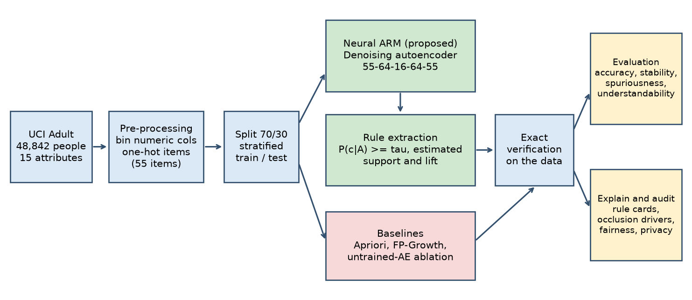

# Neural Association Rule Mining

**Neural, verified, and explainable association-rule discovery on the UCI Adult dataset.**

[](https://www.python.org/)
[](https://numpy.org/)
[](https://scikit-learn.org/)
[](https://rasbt.github.io/mlxtend/)

This project explores whether a denoising autoencoder can propose useful association rules from tabular transactions while keeping the final rule statistics exact and human-readable. The network proposes candidates; the dataset verifies them. Apriori and FP-Growth provide classical reference points.

> Course project for Data Mining (CSBP320), Fall 2026. Results are intended for research and educational use, not for consequential decisions about people.

## Results at a glance

The headline results below are reproduced from [`results/summary.json`](results/summary.json) using the fixed seed `42`.

| Measure | Result | Interpretation |
| --- | ---: | --- |
| Neural verified rules | **1,182** | Rules surviving exact support, confidence, and lift checks |
| Recall vs. Apriori | **97.36%** | Share of Apriori's 1,214 rules recovered by Neural ARM |
| Precision vs. Apriori | **100%** | Every verified neural rule also appears in the Apriori reference set |
| Held-out replication | **100%** | Verified rules replicate on the held-out split at the reported threshold |
| Raw proposal precision | **70.1%** | Fraction of neural candidates that pass exact verification |
| Productivity pruning | **1,172 → 479** | Compact rule set after removing unproductive supersets |
| Privacy stress test | **F1 = 0.984 at ε = 1** | Rule recovery under Laplace noise in the verification statistics |

These numbers describe this experiment and threshold configuration. They do not show that Neural ARM is universally better than Apriori; the neural model is primarily a learned proposal mechanism with exact data-side verification.

## Workflow



1. Load and discretize the UCI Adult data into categorical transaction items.
2. Train a NumPy denoising autoencoder to reconstruct masked transactions.
3. Use reconstruction probabilities to propose rules of the form `A => c`.
4. Verify every proposal against exact support, confidence, and lift statistics.
5. Compare with Apriori, FP-Growth, and an untrained-network ablation.
6. Evaluate stability, calibration, explainability, fairness-related disparities, and privacy utility.

## What is included

- A pure-NumPy denoising autoencoder with a `55 → 64 → 16 → 64 → 55` architecture.
- Classical Apriori and FP-Growth baselines implemented with `mlxtend`.
- Exact rule verification and productivity pruning.
- Natural-language rule cards and neural occlusion attribution.
- Reproducible CSV result tables and nine experiment figures.
- A report and presentation in [`report/`](report/).

## Reproduce the experiments

### Requirements

- Python 3.10 or newer
- `pip`
- About 2 GB of free memory for the full experiment

Create an isolated environment and install the dependencies:

```bash
python -m venv .venv
# Windows PowerShell
.\\.venv\\Scripts\\Activate.ps1
# macOS/Linux
# source .venv/bin/activate
python -m pip install --upgrade pip
python -m pip install -r requirements.txt
```

Run the full experiment suite from the repository root:

```bash
python run_all.py
```

The run writes updated tables to `results/` and figures to `figures/`. The current reference run takes approximately 7 minutes on a typical 2-core machine; runtime varies with hardware and package versions.

To rebuild the report and presentation after regenerating the results:

```bash
python build_report.py
python make_slide_numbers.py
npm install pptxgenjs
node build_slides.js
```

## Repository layout

```text
.
├── data/        UCI Adult CSV used by the experiments
├── figures/     Reproducible plots used in the README and report
├── report/      DOCX report and PPTX presentation
├── results/     CSV tables, run log, and summary.json
├── src/         Data preparation, mining, neural model, explanations
├── run_all.py   Main experiment runner
├── build_report.py
├── build_slides.js
├── requirements.txt
└── QA_prep.md   Project defense / review preparation notes
```

## Dataset and attribution

The project uses the **Adult** (also known as **Census Income**) dataset from the [UCI Machine Learning Repository](https://archive.ics.uci.edu/dataset/2/adult). UCI describes it as census-derived data for predicting whether annual income exceeds `$50K`; the dataset contains 48,842 instances and missing values in several attributes. The local CSV is retained for reproducibility and should be treated as third-party data with its original attribution.

The analysis intentionally includes demographic attributes such as `sex` and `race` in parts of the audit. These variables are used to measure representation and disparity in the experiment, not to endorse demographic profiling.

## Limitations

- Association rules are correlations, not causal explanations.
- The Adult dataset is historical and contains known social and measurement limitations.
- Fairness metrics are dataset- and threshold-dependent; the audit is not a fairness certification.
- Privacy results are a controlled noise experiment, not a formal end-to-end differential-privacy guarantee.
- Exact reproduction can vary slightly with dependency versions and hardware.

## License and reuse

No open-source license has been selected for the project code yet. The dataset is third-party, and the report/presentation may include course or team-owned material. Please contact the project owner before reusing or redistributing project materials until a license is added.

## Acknowledgments

- UCI Machine Learning Repository and the original Adult dataset contributors.
- `mlxtend` for the Apriori, FP-Growth, and association-rule implementations used as baselines.
